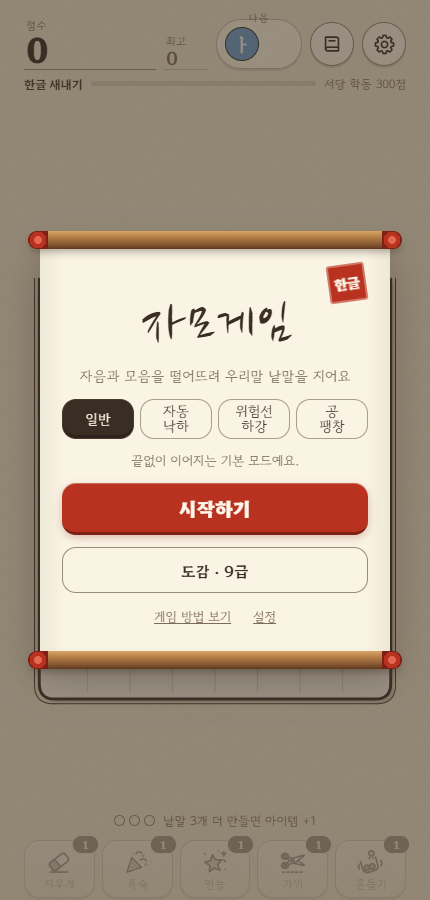
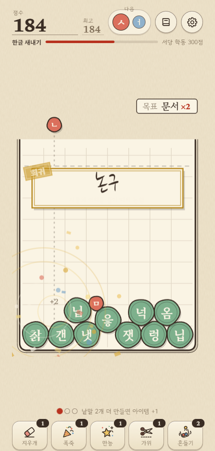
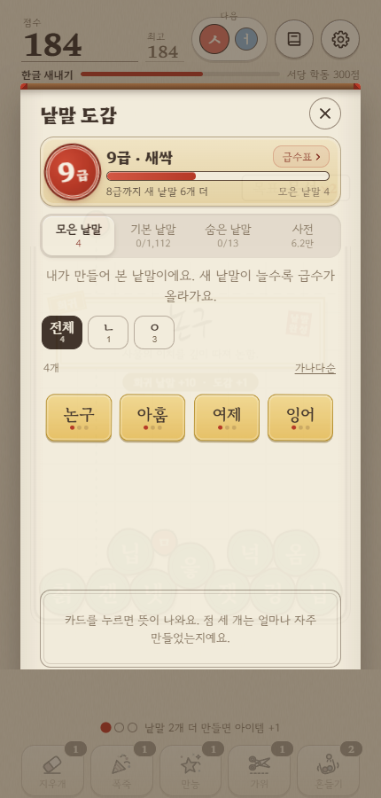
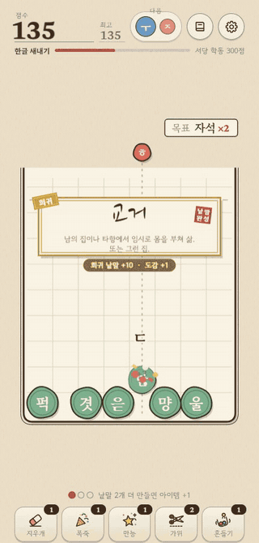
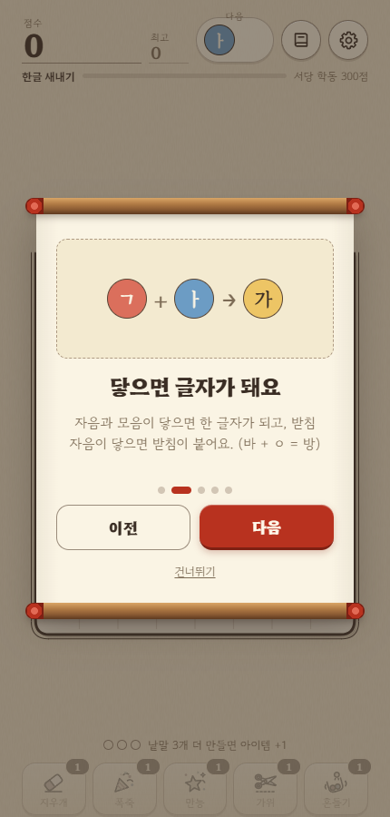
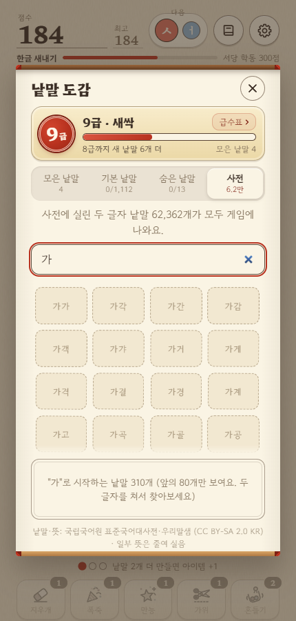
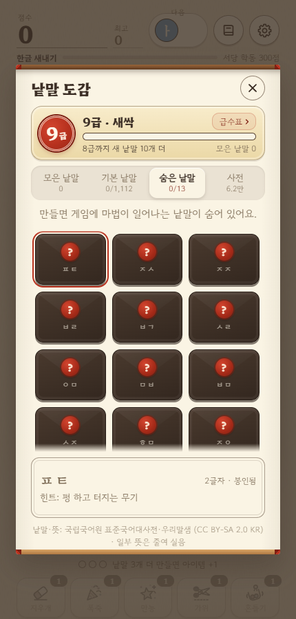
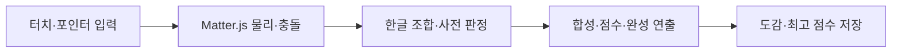

<div align="center">

# 자모게임

**자음과 모음이 만나 글자가 되고, 글자가 만나 우리말이 됩니다.**

한글의 조합 원리를 놀이로 풀어낸 물리 퍼즐 게임


### [▶ 지금 플레이하기](https://jangabc3.github.io/jamo-game/)

설치·회원가입 없이 브라우저에서 실행 · 모바일 터치 지원 · 광고 없음

</div>

## 화면 미리보기

<table>
  <tr><th width="33%">시작 · 모드 선택</th><th width="34%">플레이 · 낱말 완성</th><th width="33%">수집 · 낱말 도감</th></tr>
  <tr>
    <td><a href="assets/screenshots/01-start.png"></a></td>
    <td><a href="assets/screenshots/03-play.png"></a></td>
    <td><a href="assets/screenshots/04-collected.png"></a></td>
  </tr>
</table>

현재 코드를 실행해 직접 조작한 화면입니다. 이미지를 누르면 원본 크기로 볼 수 있습니다.

<details>
<summary><b>🎬 실제 플레이 GIF 보기</b></summary>

자모를 떨어뜨리고, 글자를 합치고, 낱말을 완성하는 과정입니다. 실제 브라우저 화면을 연속 녹화한 15fps 미리보기입니다. 오디오는 포함하지 않습니다.

<p align="center"></p>

</details>

<details>
<summary><b>📖 게임 방법 · 사전 검색 · 숨은 낱말 화면</b></summary>

<table>
  <tr><th width="33%">글자 조합 안내</th><th width="34%">낱말 사전 검색</th><th width="33%">숨은 낱말 · 힌트 펼치기</th></tr>
  <tr>
    <td><a href="assets/screenshots/02-how-to-play.png"></a></td>
    <td><a href="assets/screenshots/05-dictionary.png"></a></td>
    <td><a href="assets/screenshots/06-magic-hint.png"></a></td>
  </tr>
</table>

</details>

## 어떻게 플레이하나요?

**좌우로 위치 선택 → 손을 떼어 낙하 → 글자 조합 → 낱말 완성·수집**

`ㄱ + ㅏ → 가` · `바 + ㅇ → 방` · `가 + 방 → 가방`

공이 닿으면 한글 조합 규칙에 따라 합쳐집니다. 두 글자가 사전에 있는 낱말이 되면 터지고 점수를 얻습니다. 공이 위험선 위로 쌓이기 전에 낱말을 완성하는 것이 목표입니다.

## 핵심 기능

| 기능 | 구현 내용 |
| :--- | :--- |
| **한글 물리 퍼즐** | 자음·모음·받침 결합, 겹모음·겹받침, 충돌에 따른 합성·낱말 판정 |
| **낱말 수집·검색** | 두 글자 낱말 **62,362개**, 기본 낱말 **1,112개**, 수집 횟수·숙련도·급수 |
| **모드와 아이템** | 일반·자동 낙하·위험선 하강·공 팽창, 지우개·폭죽·만능·가위·흔들기 |
| **숨은 낱말** | 13개 낱말에 연결된 마법 효과·한글 연출, 발견 기록과 힌트 |
| **손맛과 피드백** | 연쇄·콤보, 낱말 완성 연출, Web Audio 효과음·배경음, 점수 공유 이미지 |
| **오프라인 플레이** | 글꼴·물리 엔진·사전 포함 PWA, 도감·최고 점수의 로컬 저장 |

사전 데이터 중 일부 낱말에 뜻풀이가 포함되어 있습니다. 끝말잇기·같은 공 대결·한 글자 낱말은 현재 설정에서 비활성화되어 있습니다.

## 기술 스택

| 구분 | 사용 기술 |
| :--- | :--- |
| **화면·입력** | JavaScript · HTML5 · CSS3 · Canvas 2D · Pointer Events |
| **물리·소리** | Matter.js 0.19 · Web Audio API |
| **저장·오프라인** | localStorage · Service Worker · Cache API · Web App Manifest |
| **빌드·배포** | Python · GitHub Pages |

백엔드 서버와 외부 런타임 API 없이 브라우저에서 동작합니다. Capacitor는 앱 패키징을 위한 설정 단계이며, 스토어 출시 완료를 의미하지 않습니다.

## 설계 포인트

| 고려한 문제 | 구현 방식 | 코드 |
| :--- | :--- | :--- |
| **물리 충돌과 한글 규칙의 분리** | `rule(A, B)`에서 합성·낱말 여부를 판정하고, 충돌 처리에서 결과를 큐에 넣어 적용 | [한글 규칙](src/js/05-rules.js) · [충돌 처리](src/js/06-physics.js) |
| **사전 조회와 수집 데이터 구분** | 낱말은 `Set`으로 판별하고, 글자별 짝 목록을 구성. 수집 횟수는 별도로 저장해 도감·숙련도에 사용 | [사전·도감 데이터](src/js/03-dictionary.js) |
| **프레임 지연 시 물리 처리** | 물리를 1/60초 단위로 갱신하고 프레임당 반복 횟수를 제한. 저성능 환경에서는 캔버스 해상도를 조정 | [게임 루프](src/js/22-loop.js) · [화면 크기 처리](src/js/23-main.js) |
| **네트워크 없이 다시 실행** | 정적 파일을 사전 캐시하고 빌드 결과의 해시로 캐시 버전을 생성 | [서비스 워커](docs/sw.js) · [빌드 스크립트](tools/build.py) |



도감과 기록은 같은 브라우저에 저장됩니다. 기기 간 동기화는 지원하지 않으며 사이트 데이터를 지우면 기록도 초기화됩니다. 오프라인 실행은 최초 접속과 리소스 캐시가 완료된 이후에 가능합니다.

<details>
<summary><b>프로젝트 구조</b></summary>

```text
jamo-game/
├── src/
│   ├── index.html       # 게임 화면
│   ├── css/             # 한지·붓글씨 스타일, 모션, 도감
│   └── js/              # 한글 규칙 → 물리 → UI → 렌더링·루프
├── data/dict.txt        # 낱말·뜻풀이·등급
├── public/              # 글꼴, Matter.js, PWA 아이콘
├── tools/               # 빌드·뜻풀이 수집 도구
├── docs/                # GitHub Pages 배포 결과
└── assets/screenshots/  # README 실제 화면·플레이 GIF
```

JavaScript 파일은 번호 순서로 로드하며 같은 전역 범위를 공유합니다. 원본 수정은 `src/`에서 진행하고 빌드로 `docs/`에 반영합니다.

</details>

## 로컬 실행

Python 3로 별도 패키지 설치 없이 실행할 수 있습니다.

```bash
# 현재 배포 결과 실행
python -m http.server 8000 --directory docs
```

브라우저에서 **http://localhost:8000**에 접속합니다.

<details>
<summary><b>원본 수정 후 빌드하기</b></summary>

```bash
python tools/build.py
```

`docs/` 배포 파일과 `dist/jamo.html` 단일 HTML을 생성합니다. 단일 HTML 버전은 글꼴·물리 엔진을 CDN에서 불러오므로, 오프라인 플레이는 리소스를 포함한 `docs/` 버전을 사용합니다.

</details>

## 출처와 관련 문서

- **낱말·뜻풀이:** 국립국어원 표준국어대사전·우리말샘, 일부 뜻풀이는 직접 작성. 사전 데이터는 CC BY-SA 2.0 KR로 배포합니다.
- **라이선스 상세:** [NOTICE.md](NOTICE.md)
- **앱 패키징 준비:** [PUBLISHING.md](PUBLISHING.md)
- **개인정보처리방침:** [웹에서 보기](https://jangabc3.github.io/jamo-game/privacy.html)
